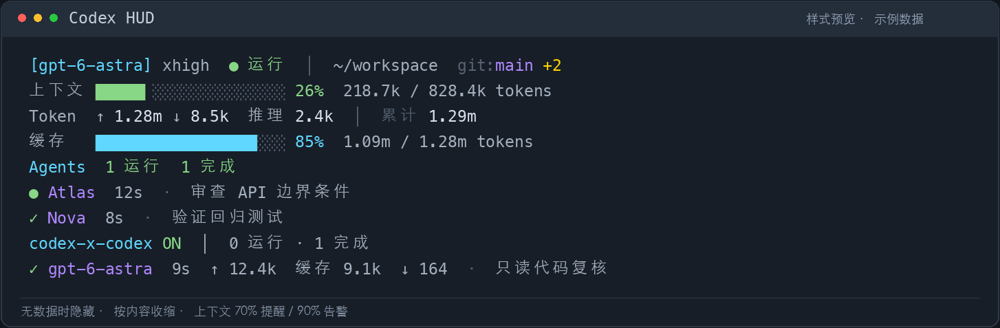

# Codex HUD

[简体中文](README.md) | [English](README.en.md)

为官方 Codex CLI 添加固定底部 HUD。安装并配置一次后，照常运行 `codex`，HUD 自动出现，无需每次运行 `codex-hud` 或手动接入 tmux。

**English:** A persistent terminal HUD for the official Codex CLI. See the selected model, context and quota progress bars, token usage, Git status, and session-scoped agent activity in a compact bottom panel. Install it through the Codex plugin manager, configure it once, and keep using `codex` as usual. [English setup and usage →](README.en.md)

 



## 安装

支持 macOS 和原生 Windows PowerShell / Windows Terminal。Git 状态显示需要 Git。

| 平台 | 依赖与后端 |
| --- | --- |
| macOS | Python 3.11+、tmux 3.2+、lsof；已在 macOS 15 / arm64 / Codex CLI 0.162.1 实测 |
| Windows | Python 3.11+、Node.js 20+（含 npm）、官方 Codex CLI；使用 ConPTY，无需 WSL 或 tmux |

macOS 缺少依赖时可以安装：

```sh
brew install python tmux
```

通过 Codex 自带的插件管理器添加本仓库并安装：

```sh
codex plugin marketplace add https://github.com/kkrr6840/codex-hud
codex plugin add codex-hud@codex-hud
```

添加市场后，也可以在 Codex 的 `/plugins` 中管理这个插件。

Windows 同样使用上面的插件安装命令。首次开启时，安装器下载固定版本的原生终端依赖；不需要自行编译。

## 配置一次，之后自动显示

安装后重新进入 Codex，在 `/skills` 中选择 **hud**，发送“开启自动 HUD”。也可以显式调用 `$hud`。配置 skill 会运行本插件的安装器，无需自己输入启动或 tmux 命令。

配置会创建用户目录下的 `~/.local/bin/codex` 启动包装，并向 shell rc 添加一段带标记的 PATH 设置。原来的 Codex 程序、登录信息、模型配置和已有 shell 函数保持原样。已有代理函数调用外部 `codex` 时，代理环境会继续传递。已有其他同名本地启动器时会停止，避免覆盖。

Windows 创建 `~/.local/bin/codex.cmd`，在已安装的 Windows PowerShell / PowerShell 7 profile 中加入带标记的 PATH 设置。首次配置后新开一次终端标签页，以后照常输入 `codex` 即可。中文路径、参数、代理环境和官方 CLI 退出码都会保留；不会更改 PowerShell 执行策略或覆盖 npm 的 `.ps1` / `.cmd`。

v0.7.1 修复官方 npm 平台包的 alias 识别，支持 `@openai/codex-win32-x64` 目录内真实包名为 `@openai/codex` 的布局，并校验版本、平台和 PE 架构。Windows 安装器会记录本次 `sys.executable`；启动器使用这个 Python 的绝对路径，不再探测 PATH 中的 `python` / `py` 或应用别名。该解释器失效时会明确提示，再运行官方 CLI。升级已有安装后，重新调用 hud skill“开启自动 HUD”一次以更新已生成的 `codex.cmd`；不要仅凭 `enabled=true` 判断 HUD 已实际启动。

**v0.4.1 起，官方 npm 符号链接入口支持旧终端直接生效，无需 `rehash`。** 安装器核对入口属于 `@openai/codex` 包的 `bin.codex`，且链接由当前用户拥有、目录可写后，把该链接接入 HUD 启动器。官方包文件保持原样，真实 CLI 路径和原链接会先保存；移除启动包装时自动恢复原链接。仅当链接仍由 HUD 管理时才恢复，保留 npm 升级或用户自行更换的入口。npm 更新如果重建了这个链接，可再次调用 hud skill“开启自动 HUD”以重新接入。

配置结果中的 `entrypoint_bridge` 表示兼容入口是否启用。启用后，旧标签页里正常运行 `codex`、`codex resume` 或 `codex fork` 就自动带 HUD；已有 alias/代理函数调用这个入口的绝对路径也生效。已经运行且不在 tmux 中的 CLI 仍需退出并进入一次。

真实二进制文件、第三方启动器和无写权限的入口不会被接管；这类安装新开一个终端标签页即可加载 PATH 集成。直接调用其他绝对路径的 alias/函数需使用 PATH 中的 `codex`。插件升级或回滚时，启动器以原生插件管理器报告的已安装版本为准。

配置 skill 也支持“关闭自动 HUD”“最大高度设为 8 行”“查看状态”“移除启动包装”。在 `/plugins` 中禁用或卸载插件后，启动包装会退回官方 CLI。需要删除包装和 PATH 标记时，通过 hud skill 执行“移除启动包装”。

## 选择显示内容（v0.4）

**按 Ctrl-b，松开后按大写 C** 打开设置菜单。Mac 中方向键选择、空格开关，`1/2/3/4` 选择精简/标准/完整/专注预设，`L` 切换布局、`G` 切换语言；Windows 中用 ↑/↓ 选择预设、Enter 应用，也可用 F8 打开。`Esc` 关闭。修改即时保存，约一秒后刷新，不用重新进入会话。两端均可通过 hud skill 修改全部设置。

v0.7 的专注布局（`focus`）减少与原生界面重复的模型、力度和路径，合并 Token 与缓存百分比，保留上下文/额度进度条、Skills 和任务活动。可以直接对 hud skill 说“使用专注布局”。已有自定义设置保留；静止画面不再重复清屏绘制，滚动、选中、尺寸或颜色变化仍会刷新。

v0.7.1 起，默认配置也使用文字缓存百分比，并尽量与 Token 合并显示。没有显示配置的新安装、没有指定缓存偏好的旧配置均自动采用新默认；显式 `cache_style="bar"`、合并布局和 `override.json` 保留。要恢复缓存进度条，可通过 hud skill 设置 `cache_style="bar"`。

v0.7.2 在运行状态旁显示独立的“本轮耗时”，根据当前主线程轮次的实际开始时间每秒刷新；即使官方 CLI 因关闭动画而不重画，它也继续计时。该数字包含工具、审批等等待时间，与官方暂停感知计时的口径不同；缺少开始时间时隐藏，结束或中断后收起。通过 hud skill 设置 `--hide turn_duration` 可隐藏。官方 CLI 0.162.1 的原始计时停帧仍需上游修复；HUD 不改写官方界面或系统动画设置。Windows 后端代码更新需下次正常进入 Codex 才生效。

v0.7.4 修复 Mac 面板中满格、接近满格或空进度条导致后续文字消失的问题；额度百分比和重置时间会继续显示。

也可以在 `/skills` 选择 **hud**，直接说“只保留模型、上下文和额度”“隐藏分流”“显示 Git 领先落后”“用英文紧凑布局”。高级配置同样可通过这个 skill 修改，无需手改配置文件。

设置保存在 `~/.config/codex-hud/display.json`。可选 `override.json` 为手动覆盖层；嵌套对象逐项合并，数组替换，覆盖层优先，常规配置不会改写它。没有数据的元素不显示。`codex-hud config --describe` 列出所有有效设置及数据限制。

| 设置 | 可选内容 |
| --- | --- |
| 显示项目 | 模型、力度、状态、目录、额外目录、Git、提供商、会话名、版本、订阅计划、上下文、5 小时/周/其他额度、Token、缓存、工具、MCP、子 agent、计划、会话时间、开始时间、最近响应、压缩次数、配置数量、RAM、分流、自定义文字 |
| 布局 | `layout`: expanded/compact；`order` 区域顺序、`header_order` 首行顺序、`merge_groups` 合并行、`right_align` 合并行右对齐、`separators` 分隔线、`max_width` 最大宽度、`height` 最大行数 |
| 上下文 | `context_value`: percent/tokens/remaining/both；`context_bar`；`context_window` 可选手动分母（显示星号）；警告/严重阈值 |
| 额度 | `quota_value`: used/remaining；`quota_style`: bar/text/compact；`reset_format`: relative/absolute/both/elapsed/elapsed_absolute；时制、秒、显示阈值、消耗速度提示 |
| Git | dirty、ahead_behind、file_stats、worktree、wrap、push_warning、push_critical |
| 样式 | 简体/繁体/英文、路径层数、模型简称/覆盖、力度文字/符号、提供商标签、自定义文字、颜色名/256 色/#rrggbb、单列宽进度条字符 |
| 活动 | `skills_limit`、`tools_limit`、`agents_limit`、`agents_show_completed`、`agents_show_failed`、`tool_name_length`；工具显示最近至多 200 条记录的活动，不冒充全部历史 |

开发者也可使用 `codex-hud config --show quota_5h,quota_weekly --hide tokens`，或 `codex-hud config --set 'git.ahead_behind=true'`。预设只修改显示开关和布局，保留自定义颜色等其他设置。

## 显示内容

- 当前会话的模型、推理档位、请求输入与实际上下文窗口、累计输入/缓存/输出/推理 token。模型和力度优先使用当前线程记录，切换后约一秒更新，无需发送下一条消息；Token 和上下文容量仍来自实际请求。修改全局默认配置不等于改变每个已运行会话的模型，HUD 不会把其他会话的选择混入当前面板。
- 5 小时和每周额度的剩余百分比、进度条及本地时间的重置日期。读取当前会话收到的官方额度快照，按实际窗口长度识别，不把 primary 固定当作 5 小时；官方未返回的窗口隐藏，过期快照提示等待更新。额度随 Codex 的事件更新，不根据 token 数估算，也不额外读取登录凭据。
- 当前会话目录的 Git 分支与变更状态。
- 最近工具活动、明确的 `update_plan` 计划事件、MCP 工具名、会话名称、CLI 版本、时长和压缩次数；可选显示本地配置数量、系统物理 RAM。
- 原生子 agent 的名称、任务、状态和耗时；来自父子线程关系和轮次事件，不以进程数代替 agent 数。
- 本轮已读 Skills：来自主线程成功读取 `SKILL.md` 的命令记录，显示名称，进入下一轮后重置。任务结束后保留最近一轮列表，不混入子 agent/中转记录，也不把已安装目录或可用技能目录当作已读取。它表示已读取指令，不表示持续运行或仍全部保留在压缩后的上下文；未记录、加密或不支持的读取无法显示。
- codex-x-codex 的开关状态，以及本会话及其子 agent 关联的分流状态和完成用量；不把全局记录混入当前会话。

初次进入或切换到无数据的新会话时，面板完全隐藏；有实际数据后自动出现。缺少的字段、空 agent 和空分流区域不显示，面板高度随内容收缩。真实读取错误和已有任务的未知用量仍会明确提示。

上下文使用彩色进度条：低于 70% 为绿色，70% 起为黄色，90% 起为红色；缓存占比单独使用蓝色进度条。累计 token 是计数，不会用上下文容量作为它的错误分母。

运行、待命、完成、失败和未知状态分开显示；加密的详细任务指令显示实际任务名。上下文数字是包含系统内容的请求输入，和原生 TUI 的 token 显示口径可能不同。

主面板的“主会话 Token”优先采用 `token_usage_record.thread_token_usage`，必须匹配当前线程 ID，之后不让其他汇总事件覆盖它。原生子 agent 和分流用量仅出现在自己的活动行，不相加到主会话上下文或累计值。累计输入会重复计算各次请求送入的历史内容，所以可远大于上下文窗口；缓存属于输入的一部分。失败的分流任务未回传用量时只显示一次“未返回用量”，不填成零。

Mac 的 `Ctrl-b H` 展开或收起整个面板，在展开视图中用方向键或 `j/k` 滚动。正常输入 `/quit` 退出，两端都会清理自己的临时日志和 HUD 后台进程。

## 直接选择并查看 agent（v0.6）

在默认的空输入框中直接按 **↓**，就会选中下面 HUD 的第一个 agent，选中行高亮显示。用 **↑/↓** 切换、**Enter** 查看详情；详情中 **Esc** 返回 HUD，再按 **Esc** 返回输入框。第一项按 **↑** 也能回到输入框。有草稿、打开原生菜单或没有可选 agent 时，下箭头继续交给官方 CLI。

| 操作 | Mac | Windows |
| --- | --- | --- |
| 从空输入框选中 agent | ↓ | ↓ |
| 切换 / 查看 / 返回 | ↑↓ / Enter / Esc | ↑↓ / Enter / Esc |
| 辅助入口 | Option（⌥）+↓，或 Ctrl-b 后 ↓ | Alt+↓，或 Ctrl-b 后 ↓ |
| 设置菜单 | Ctrl-b 后大写 C | Ctrl-b 后大写 C，或 F8 |

如果 Mac 终端把 Option 当作系统快捷键，使用直接 ↓ 或 Ctrl-b 后 ↓。辅助入口在 Mac 打开列表，在 Windows 直接选中 HUD 行。

原生子 agent 和当前会话关联的分流任务均可查看任务、模型、状态、耗时、用量、最近工具和最新可读输出。状态与输出持续刷新，长回答可用上下箭头滚动；不会重启主 CLI。默认占位提示以外的输入界面使用辅助入口。

v0.6.1 起，已完成的子 agent 和分流任务自动从底部列表移除，计数和多余行同步收起；全部完成后对应区域隐藏。正在查看的详情仍可读完最终结果。若需要显示完成历史，可通过 hud skill 设置 `agents_show_completed=true`，不必重进会话。

v0.6.4 起，失败的子 agent 和分流任务也默认从底部列表与计数移除。失败记录仍保留给主会话处理和历史排查；需要查看时可通过 hud skill 设置 `agents_show_failed=true`。未结束的未知状态和活动任务的数据读取错误继续显示。

v0.7.3 修复了中转任务与其他命令放在同一次并行工具调用时，运行中的任务漏显示的问题。HUD 按工具返回的索引关联每个命令和后续轮询；不混用其他命令的状态或用量。已结束但未返回结果的任务随完成历史收起，结果和用量仍标记为未知；`agents_show_completed=true` 可查看。默认隐藏的完成或失败 agent，其旧日志缺失提示也随历史收起，活动 agent 和主会话的读取错误仍会提示。

选择器只读取日志和已返回的分流结果，不重新启动或恢复子会话，因此不会额外抢占会话写入权。原生输出读取日志尾部最多 128 KB 中最近五段 assistant 记录；继承的、早于子会话创建时间的父会话记录会排除。未保存 worker 日志的分流任务可显示其实际返回的结果；超出读取范围、加密内容和尚未产生的输出会明确提示。未知用量保持未知。Codex 的原生 **`/subagents`** 也可切换到子 agent 的完整会话界面，并继续它的工作。

Mac 插件升级后，可让 hud skill 执行 `codex-hud refresh --session <当前会话 ID>`，只替换观察面板，保持 CLI 进程和对话继续。v0.6.3 起，已打开会话的面板、方向键和菜单不依赖旧插件缓存目录；升级移除旧版本后仍可使用，无需重新进入。Windows 后端的代码升级在下次正常启动生效，两端显示配置都支持实时更新。Mac 的 `codex-hud watch --session <ID>` 可在独立终端只读监视指定会话；Windows 可用 `watch --session <ID> --once` 核对数据。

## 与 Claude HUD 的功能对照

本次对照了本机 [claude-hud](https://github.com/jarrodwatts/claude-hud) 0.11.2 的配置和渲染功能，采用独立 Python 实现。终端外观与配置方式尽量对应，数据始终来自 Codex。

| Claude HUD 功能 | Codex HUD 对应与边界 |
| --- | --- |
| 显示开关、预设、布局、排序/合并、语言/颜色、Git 详情 | 已实现；通过设置弹窗或 hud skill 修改，实时刷新 |
| 模型、路径/额外目录、力度、提供商、会话名、版本、认证计划 | 使用当前 Codex 元数据、线程数据库和返回的 plan_type；不读取凭据或用户名 |
| 上下文、额度、剩余/已用、重置时间、消耗速度提示、缓存命中率 | 已实现；按官方窗口长度识别 5 小时/7 天，其他窗口保留真实名称和分钟数；未返回则隐藏 |
| 工具、MCP、子 agent、待办、时间、压缩、RAM、配置数量 | 已实现；MCP 仅依据明确的 mcp__ 工具事件，计划仅依据明确 update_plan 事件，配置计数不等于实际加载数量 |
| 会话/每日/每周费用、路由费用、纯 API 输出速度、prompt cache 到期 | 当前 Codex 数据不完整，暂不支持；不以 token 估算真实账单，不把工具等待算成 API 速度，不猜缓存 TTL |
| Skill、advisor、输出风格、登录用户名 | 可显示本轮成功读取的 SKILL.md 名称；持续执行状态和其他专有字段缺少可靠对应，不把已读指令当成持续运行 |
| jj、外部额度文件/写出、额外状态命令、余额来源合并 | 本版未实现；不会拿 Claude 的账号窗口补 Codex 缺失额度 |
| 原生 statusLine 回调 | Mac 使用 tmux，Windows 使用 ConPTY 终端后端；未修改官方 CLI，显示配置实时更新 |

恢复长会话时读取日志末尾约 2 MB；工具历史和压缩计数可能不完整，压缩计数会标记 `≥`。官方累计 Token 由记录中的累计字段提供，不将日志尾部相加冒充总量。

## 运行方式与边界

Mac 使用独立 tmux 会话；Windows 使用原生 ConPTY，并解析终端屏幕，为 HUD 保留底部空间。两端均运行官方 CLI，为本次调用加入 `--no-daemon` 和私有临时诊断目录。CLI 配置文件中的模型、账号和权限策略继续生效。每个 HUD 按自己的诊断事件绑定线程，包括 `/new` 尚未发消息的阶段。

v0.4.2 为 tmux 外层终端声明同步绘制能力，并为 CLI 面板指定常亮光标，减少嵌套 tmux 时光标隐藏/显示被拆开呈现造成的闪烁。已有面板刷新后常亮样式立即生效；已连接客户端的终端能力由 tmux 在连接时读取，同步绘制声明在下次正常进入时生效。

`exec`、`review`、`debug`、`login`、`plugin` 等非交互命令，帮助/版本查询、管道或重定向输出、远程会话继续使用原 CLI。未知参数语法会保守透传。HUD 不改变审批或网络政策。

这是一份可通过 Codex 插件管理器安装的 skill 插件，加上一次性的本地启动集成。Codex 的[原生状态栏](https://learn.chatgpt.com/docs/cli/slash-commands#configure-footer-items-with-statusline)通过 `/statusline` 配置内建字段；本插件的 agent 和分流面板由终端后端渲染。

## 开发与检查

```sh
python3 -m unittest discover -s tests -v
npm ci --prefix native --include=optional
node --test tests/native_terminal.test.cjs
```

测试覆盖会话隔离、`/new` 切换、状态及未知用量、透明参数转发、已有启动器保护，以及真实 tmux/PTY 和 ConPTY 的按键、数据桥、中文路径、刷新和退出清理。Windows 验收通过 [GitHub Actions](https://github.com/kkrr6840/codex-hud/actions/workflows/windows-native.yml) 执行，不需要模型请求或账号凭据。

许可证：MIT。
